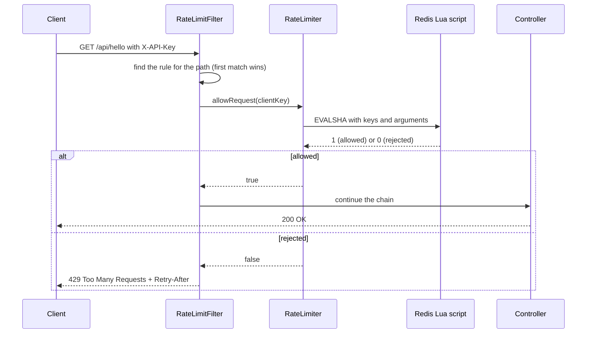

# rate-limiter-demo

A Spring Boot service that rate-limits its own API using the **[rate-limiter](https://github.com/sakshijayasingh2002-lgtm/rate-limiter)** library. Limits are configured **per route in `application.yml`**, and the whole thing runs as three instances behind one shared Redis to show that the limits hold across instances.

## How it works

A servlet filter runs before every request. It finds the first rule that matches the path, asks that rule's limiter whether this client may continue, and answers `429 Too Many Requests` right away if not, so the controller is never reached.



The filter only knows the `RateLimiter` interface. It does not know which algorithm a rule uses.

## Endpoints

Defaults from `application.yml`:

| Route | Algorithm | Limit |
|---|---|---|
| `GET /api/hello` | Token Bucket | burst of 5, then 1 per second |
| `GET /api/search?q=...` | Sliding Window Counter | 5 per 10 seconds |
| `GET /api/orders` | Leaky Bucket | queue of 3, drains 1 per second |
| `GET /api/report` | Sliding Window Log | 2 per 15 seconds (exact) |
| `GET /api/**` (anything else) | Token Bucket | burst of 20, then 5 per second |
| `GET /health` | none | never limited |

Each rule has its **own** counters per client: using up `/api/report` does not use up `/api/hello`.

A rejected request gets:

```
HTTP/1.1 429
Retry-After: 15
X-RateLimit-Rule: report
Content-Type: application/json;charset=UTF-8

{"error":"rate_limited","message":"Too many requests, slow down."}
```

**Who is "the client"?** The `X-API-Key` header if present, otherwise the caller's IP address. `X-Forwarded-For` is deliberately not trusted, because any client can set it and dodge the limit.

## Configuration

Rules live under `ratelimiter.rules` and are checked **top to bottom; the first match wins**, so put specific paths before general ones.

```yaml
ratelimiter:
  redis:
    host: localhost
    port: 6379
  rules:
    - name: report
      path: /api/report
      algorithm: sliding-window-log
      limit: 2
      window-seconds: 15

    - name: default          # catch-all goes last
      path: /api/**
      algorithm: token-bucket
      capacity: 20
      refill-per-second: 5
```

| `algorithm` | Settings it needs |
|---|---|
| `token-bucket` | `capacity`, `refill-per-second` |
| `leaky-bucket` | `capacity`, `leak-per-second` |
| `sliding-window-counter` | `limit`, `window-seconds` |
| `sliding-window-log` | `limit`, `window-seconds` |

Every rule also needs a unique `name` and a `path` (Ant-style patterns such as `/api/**`). A typo or a missing setting fails at **startup** with a message naming the rule and the setting, instead of surfacing later on a real request. A path that matches no rule is not limited.

## Run it locally

**Requirements:** Java 17, Maven, Docker.

1. Install the library into your local Maven repository (from the `rate-limiter` repo):
   ```
   mvn install
   ```
2. Start Redis:
   ```
   docker run -d --name redis-rl -p 6379:6379 redis:7
   ```
3. Run this project:
   ```
   mvn spring-boot:run
   ```
4. Try it. Refresh `http://localhost:8080/api/hello` quickly: the first 5 succeed, then you get `429`.

## Run three instances with Docker Compose

Build the jar, then start Redis plus three copies of the service:

```
mvn clean package -DskipTests
docker compose up --build -d
```

| Service | URL |
|---|---|
| app1 | http://localhost:8081 |
| app2 | http://localhost:8082 |
| app3 | http://localhost:8083 |

Redis has no published port. Only the three apps, on the Compose network, can reach it. Each container is told its name through `INSTANCE_NAME` (shown as `servedBy` in responses) and where Redis is through `RATELIMITER_REDIS_HOST`.

### Prove the limit is shared (Windows PowerShell)

```
powershell -ExecutionPolicy Bypass -File prove-distributed.ps1
```

The script sends 9 requests with one API key to `/api/report` (limit: 2 per 15 seconds), rotating across the three instances. Per-instance counting would allow 6. Because the state is in Redis, exactly 2 are allowed:

```
Allowed: 2   Rejected: 7   (limit is 2 in total)
PASS - the limit held across all three instances.
```

### Load test

```
run-loadtest.cmd
```

This runs [k6](https://k6.io) inside Docker, on the Compose network (takes about 35 seconds). On macOS or Linux, the equivalent is:

```
docker run --rm -i --network rate-limiter-demo_default -e API_KEY=load$RANDOM grafana/k6 run - < loadtest.js
```

Two scenarios against `/api/hello`:

| Scenario | Expected allowed |
|---|---|
| One client at 50 req/s for 20 s, spread over the 3 instances. Burst 5 + 20 s of refill is about 25 out of about 1000. | 20 to 30 |
| Ten clients at about 3 req/s each for 10 s. Each has its own bucket (about 14 allowed each). | 120 to 170 |

The script ends with a PASS/FAIL verdict. It is built to catch the bug this project exists to prevent: if each instance kept a private bucket, the single client would get about three times as many requests through (around 75), far outside the expected 20 to 30, and the run would end in FAIL.

The expected ranges assume the default limits in `application.yml`. If you change them, update `EXPECT` and `thresholds` in `loadtest.js`.

### Things to try

- `docker compose stop app2`, then run the proof again. It still passes: the limit lives in Redis, not in any one instance.
- `docker compose stop redis`, then call `http://localhost:8081/api/hello` repeatedly. Requests are allowed (the limiter **fails open**), and the logs (`docker compose logs app1`) show one warning, not one per request. `docker compose start redis` and limiting resumes.

## Tests

```
mvn test
```

21 tests, none of which need Redis or a Spring context. They cover what the filter does with the limiter's answer (allowed, rejected with `429` and `Retry-After`, paths with no rule, which rule applies to which route), how rules are matched (first match wins), and that every algorithm name builds the right limiter and that bad configuration fails with a clear message.

## Notes and limitations

- **Behind a load balancer or proxy**, the IP the service sees is the proxy's, so every client without an API key would share one bucket. A production setup would read `X-Forwarded-For` only from a trusted proxy.
- **Limits are read at startup.** Changing `application.yml` needs a restart.
- **No per-user tiers** (for example, different limits for free and paid keys).
- **Redis is a dependency of every decision.** See the library README for the failure behavior and the trade-offs.
